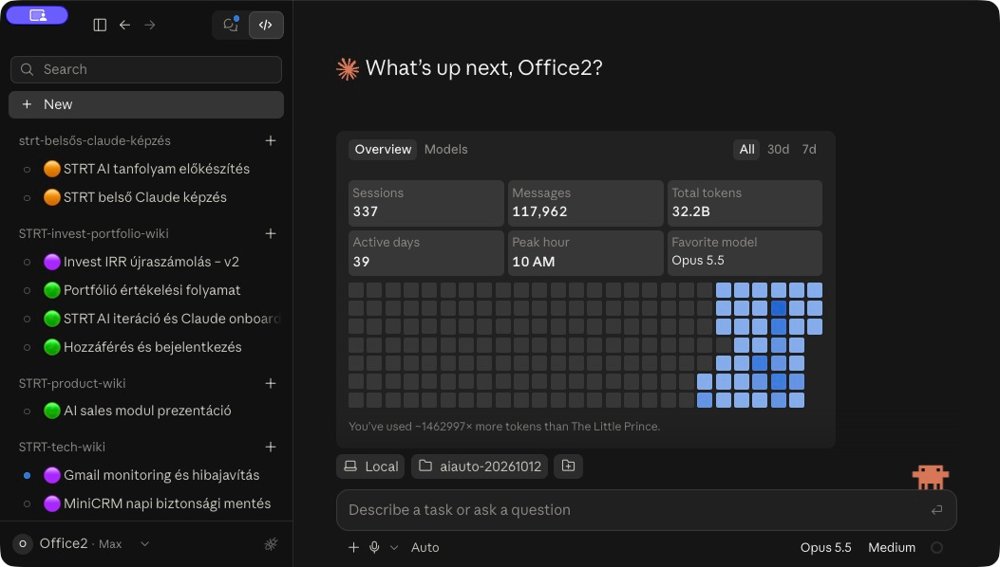

# AI Colored Chat Status

**Know which Codex or Claude Code chat is working, waiting, scheduled, or done—at a glance.**

[](LICENSE)
[](chat-status/SKILL.md)
[](#requirements)

Chat Status is a small agent skill that adds a colored circle to your existing chat title. It preserves the title you chose and updates the prefix as work progresses.



## Install with your agent

Paste this into **Codex desktop or Claude Code**:

```text
Install https://github.com/frkandris/ai-colored-chat-status and follow its setup guide to enable chat status tracking on every turn.
```

Use the same prompt in each agent if you want both. See the [manual setup](#quick-start) for details.

## Status colors

| Circle | Status | When it appears |
| --- | --- | --- |
| 🔵 | **Running** | The agent is actively working or waiting for a running tool. |
| 🟡 | **Needs input** | Progress depends on your answer, approval, or access. |
| 🟣 | **Scheduled** | This run has ended and a confirmed, enabled future run is attached to this chat. |
| 🟢 | **Complete** | The requested work is finished and no future run is attached. |

A blocking dependency takes priority over active work. After a run ends, a verified future schedule takes priority over completion. An idle or interrupted agent is not automatically marked complete.

## Requirements

| Platform | Adapter | Requirements |
| --- | --- | --- |
| **Codex desktop** | Native desktop title tools | `mcp__codex_app__list_threads` and `mcp__codex_app__set_thread_title` |
| **Claude desktop app (Code tab)** | Native session tools | `get_session` and `set_session_title` |
| **Claude Code CLI (local)** | Bundled Python helper → documented `/rename` CLI command | Claude Code 2.1.295+, Python 3.9+, exact current session ID and persisted title |

Install the same skill folder in either or both platforms. Enable the persistent instruction for lifecycle updates on every turn. No daemon, browser extension, or separate API key is required.

The Claude Code adapter was smoke-tested on **2.1.295**. Plain Claude web/Cowork chats, remote-only Claude sessions, and Codex CLI sessions without desktop title tools are outside this release's scope.

## Context cost

The always-on part is a short global instruction of about 500 characters that carries the four states and the priority rule itself. The full `SKILL.md` (about 2,000 characters) is read only when needed: once per session in the Claude Code CLI to get the rename command, or when a chat, title, or schedule is unclear. Platform edge cases live in `references/` and are read on demand.

Global instructions sit at the start of every context window, so they are kept deliberately short.

## Quick start

### Codex desktop

#### 1. Install the skill

Clone the repository and copy the skill into your user-level skills directory:

```bash
git clone https://github.com/frkandris/ai-colored-chat-status.git
mkdir -p ~/.agents/skills
cp -R ai-colored-chat-status/chat-status ~/.agents/skills/
```

If you already have a `chat-status` installation, back it up or deliberately replace it rather than creating a nested duplicate. The repository root is the package; the inner `chat-status/` folder is the installable skill.

Codex's [official skill documentation](https://learn.chatgpt.com/docs/build-skills) describes current discovery locations. Restart Codex if the skill does not appear.

#### 2. Try it in a chat

```text
Use $chat-status during this task. Summarize the README in this repository.
```

The title should become 🔵 while the agent works, then 🟢 when it finishes. Explicit invocation applies to the current task; use global activation for ongoing tracking.

#### 3. Enable it for every turn

Follow the [global activation guide](chat-status/references/global-activation.md) to add a short (~500 character) instruction to your Codex home `AGENTS.md`. The guide includes the exact snippet, path resolution, precedence rules, verification, and removal steps.

Installation alone does not guarantee the skill is loaded on every turn. Each enabled chat updates its own title as it runs.

### Claude Code

From the directory where you cloned the repository:

```bash
mkdir -p ~/.claude/skills
cp -R ai-colored-chat-status/chat-status ~/.claude/skills/
```

Initialize a session name if needed, then invoke the skill:

```text
/rename Fix the checkout bug
/chat-status
```

See the [Claude Code guide](chat-status/references/claude-code.md) for requirements, the exact session adapter, global activation through `CLAUDE.md`, and troubleshooting. Installing in one platform does not install it in the other.

## How it works

1. Read and identify the current chat's title through the appropriate platform adapter.
2. Select a state from the actual task outcome and any verified schedule.
3. Replace existing leading status circles with exactly one circle and one space.
4. Preserve the descriptive title verbatim, including its language and other emoji.

For example, `🟡 🔵 Fix checkout` becomes `🟢 Fix checkout` when the work is complete. A user rename is preserved on the next update. Subagents do not rename their parent's chat.

The skill only changes chat titles. In Claude Code, the helper reads the exact session’s title metadata and calls the official CLI rename command; it does not write transcripts directly. It does not create schedules, send notifications, or inspect external services merely to choose a color.

## Limitations

- Updates happen when the agent can act. This is **not real-time event synchronization**.
- Crashes, forced interruptions, unexpected approval prompts, or schedule changes made elsewhere can leave a prefix stale until another turn.
- If the current chat cannot be identified reliably, the skill leaves its title unchanged.
- Missing platform capabilities cannot be supplied by installing a Markdown skill.
- Claude Code needs a resolvable local session and title. Unsupported versions, host restrictions, or missing title metadata cause the adapter to stop without guessing another session.
- Claude Code may cache the visible title until the UI refreshes; saved-title verification does not prove immediate live UI refresh.
- Global activation does not install or enable the skill on another person's computer.

## Repository layout

```text
ai-colored-chat-status/
├── README.md
├── LICENSE
└── chat-status/
    ├── SKILL.md                       # Agent instructions (short)
    ├── agents/openai.yaml             # English UI metadata
    ├── references/
    │   ├── codex.md                     # Codex edge cases (read on demand)
    │   ├── global-activation.md         # Codex setup
    │   └── claude-code.md               # Claude Code setup
    └── scripts/claude_code_status.py    # Local Claude Code adapter
```

## Contributing

Issues and focused pull requests are welcome. Describe the environment, the expected title, and the observed result. Use fictional examples or redact private chat content.

Keep platform adapters small and use supported interfaces. Preserve the title, use verified state evidence, and avoid claiming support for tools the target environment does not expose. When changing lifecycle behavior, check active work, required input, completion, and a verified attached schedule.

## Origin and license

Created by [András Tóth](https://github.com/frkandris). This English edition is adapted from the `chat-status` skill in the STRT skills collection, source revision `3b0c4415280047249925da787cf33b9ee2689266` (2026-10-12). It retains the four-state lifecycle and title-preservation behavior, with English metadata and setup documentation. The Claude Code adapter adds a supported CLI path for the same lifecycle.

Released under the [MIT License](LICENSE). This is an independent project and is not affiliated with or endorsed by OpenAI or Anthropic.
